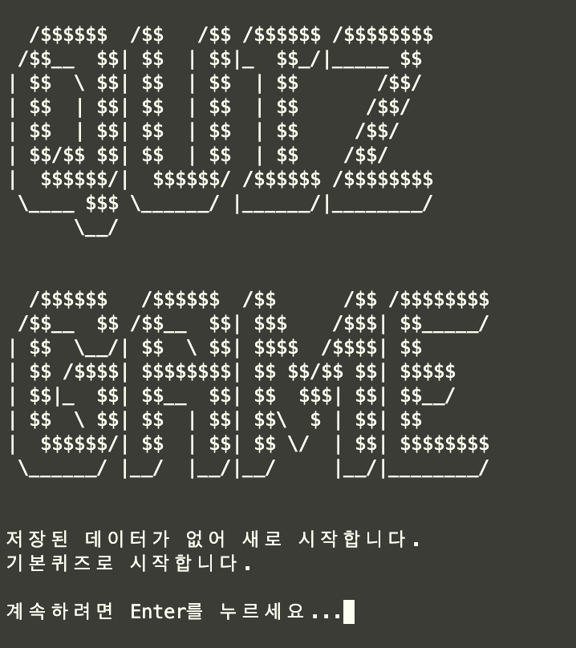
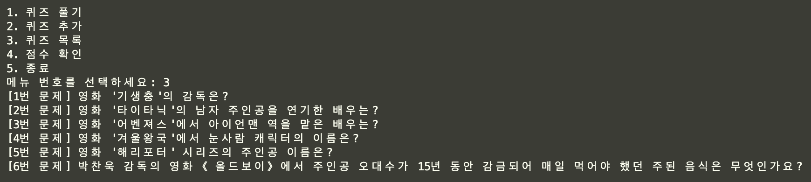

# E1-2 컴퓨터에게 명령 내리는 말(파이썬) 처음 배우기

# 🎬 영화 퀴즈 게임

## 📌 프로젝트 개요
터미널에서 즐기는 영화 퀴즈 게임입니다.
사용자가 퀴즈를 풀고 점수를 기록하며, 최고 점수가 저장됩니다.
새로운 퀴즈를 직접 추가할 수도 있습니다.

## 🎯 퀴즈 주제와 선정 이유
- **주제**: 영화
- **선정 이유**: 한 번쯤 영화를 본 기억이 있는 사람들이 많다고 생각했습니다. 영화는 여러 사람에게 친숙한 주제라서 누구나 쉽게 즐길 수 있을 것 같아 선택했습니다. 저도 평소에 영화를 좋아하는 편입니다.

## 🖥️ 개발 환경

- 운영체제: Linux
- 에디터: Visual Studio Code
- 언어: Python 3.14.4
- 버전 관리: Git 2.53.0, GitHub


## ▶️ 실행 방법
```bash
python3 main.py
```
> Python 3.10 이상 환경에서 실행 가능하며, 개발은 Python 3.14.4 환경에서 진행했습니다.

## ✨ 기능 목록
- 퀴즈 풀기 (정답 확인 및 점수 계산)
- 최고 점수 기록 및 갱신
- 새 퀴즈 추가
- 게임 데이터 저장 / 불러오기 (JSON)
- 파일 없음·손상 시 예외 처리

## 📁 파일 구조
```
프로젝트/
├── main.py            # 프로그램 진입점, 메뉴 루프
├── state.json         # 게임 데이터 저장 파일
├── docs/
│   └── screenshots/   # 실행 화면 캡처 이미지
└── game/
    ├── __init__.py    # 패키지 초기화
    ├── util.py        # 공용 유틸 함수
    ├── quiz.py        # Quiz 클래스
    └── quizgame.py    # QuizGame 클래스 (핵심 로직)
```

## 🗂️ 데이터 파일 설명 (state.json)
- **경로**: 프로젝트 루트 (`./state.json`)
- **역할**: 최고 점수와 퀴즈 목록을 저장/불러오기
- **인코딩**: UTF-8
- **스키마**:
```text
{
  "quizzes": [
    {
      "question": string,
      "choices": string[],
      "answer": int
    }
  ],
  "best_score": {
    "correct": int,
    "total": int
  }
}
```
- `question`: 퀴즈 문제 내용
- `choices`: 객관식 보기 목록
- `answer`: 정답 번호
- `best_score.correct`: 최고 점수에서 맞힌 문제 수
- `best_score.total`: 최고 점수 당시 전체 문제 수

## 📷 실행 화면

### 로고 


### 메인 메뉴


### 퀴즈 풀기


### 퀴즈 추가


### 점수 확인


### 퀴즈 목록



## 🧾 Git 커밋 기록

```bash
git log --oneline --graph
```


## 📍Git 저장소 복제 및 pull 실습

퀴즈 게임 개발 완료 후, `clone`과 `pull` 명령어를 실습하였다.

### 1. 저장소 복제

원격 저장소를 별도의 로컬 디렉터리에 복제하였다.

```bash
git clone git@github.com:kyu99-dev/E1-2.git
```

실행 결과:

```text
Cloning into 'E1-2'... 
remote: Enumerating objects: 59, done.
remote: Counting objects: 100% (59/59), done.
remote: Compressing objects: 100% (41/41), done.
remote: Total 59 (delta 24), reused 48 (delta 16), pack-reused 0 (from 0)
Receiving objects: 100% (59/59), 461.54 KiB | 816.00 KiB/s, done.
Resolving deltas: 100% (24/24), done.
```

### 2. 복제된 저장소에서 변경 후 push

복제된 저장소에서 README.md에 git clone 로그를 추가한 뒤 commit 후 push하였다.

```bash
git add .
git commit -m "docs: clone 실습 문구 추가"
git push
```

### 3. 기존 로컬 작업 디렉터리에서 pull

기존 로컬 작업 디렉터리에서 원격 저장소의 변경사항을 가져왔다.

```bash
git pull
```

실행 결과:

```text
Updating 7baed6a..e3afa59
Fast-forward
 README.md | 16 +++++++++++++++-
 1 file changed, 15 insertions(+), 1 deletion(-)
```

### 4. 실습 결과

`git pull` 실행 결과 변경사항이 정상 반영되었다.  
이를 통해 clone한 저장소에서 push한 README.md 변경사항이 기존 로컬 작업 디렉터리에 성공적으로 적용되었음을 확인하였다.
## 🛠️ Git 기초 명령어 사용 증빙

프로젝트 진행 과정에서 Git 기초 명령어 7종을 각각 한 번 이상 사용하였다.

| 명령어 | 사용 내용 | 증빙 |
|---|---|---|
| `git init` | 프로젝트 폴더를 Git 저장소로 초기화 | 초기 커밋 및 Git 저장소 생성 |
| `git add` | 변경 파일을 스테이징 영역에 추가 | 여러 커밋 생성 과정에서 사용 |
| `git commit` | 변경 사항을 커밋으로 저장 | `git log --oneline --graph` 결과 |
| `git push` | 로컬 커밋을 GitHub 원격 저장소에 업로드 | `origin/main`이 `HEAD -> main`과 동일 |
| `git pull` | 원격 저장소 변경 사항을 로컬에 반영 | Fast-forward 실행 결과 기록 |
| `git checkout` | 브랜치 이동 및 작업 브랜치 사용 | `feature/quiz-play` 브랜치에서 `main` 브랜치로 이동한 기록 |
| `git clone` | 원격 저장소를 별도 폴더에 복제 | clone 실행 결과 기록 |

### git checkout 실행 결과
---
```bash
git branch
```
```text
* feature/quiz-play
  main
```
---
```bash
git checkout main
```

```text
Switched to branch 'main'
Your branch is up to date with 'origin/main'.
```