# E1-2 컴퓨터에게 명령 내리는 말(파이썬) 처음 배우기

# 🎬 영화 퀴즈 게임

## 📚 목차

| 번호 | 항목 | 확인 내용 |
|---|---|---|
| 1 | [프로젝트 개요](#-프로젝트-개요) | 영화 퀴즈 게임의 목적과 전체 설명 |
| 2 | [퀴즈 주제와 선정 이유](#-퀴즈-주제와-선정-이유) | 영화 퀴즈를 선택한 이유 |
| 3 | [개발 환경](#️-개발-환경) | 운영체제, 에디터, Python, Git 환경 |
| 4 | [실행 방법](#️-실행-방법) | `main.py`를 이용한 프로그램 실행 방법 |
| 5 | [기능 목록](#-기능-목록) | 기본 기능과 보너스 기능 정리 |
| 6 | [파일 구조](#-파일-구조) | `main.py`와 `game` 패키지 구성 |
| 7 | [데이터 파일 설명](#️-데이터-파일-설명) | `state.json`, `history.json`의 역할과 저장 구조 |
| 8 | [실행 화면](#-실행-화면) | 로고, 메뉴, 퀴즈 실행 화면 캡처 |
| 9 | [보너스 과제 구현 내용](#-보너스-과제-구현-내용) | 랜덤 출제, 문제 수 선택, 힌트, 삭제, 점수 히스토리 |
| 10 | [GitHub 저장소 URL](#-github-저장소-url) | 프로젝트 원격 저장소 주소 |
| 11 | [Git 커밋 기록](#-git-커밋-기록) | `git log`를 통한 커밋 내역 확인 |
| 12 | [Git 저장소 복제 및 pull 실습](#git-저장소-복제-및-pull-실습) | `git clone`, `git pull` 실습 과정 |
| 13 | [Git 기초 명령어 사용 증빙](#️-git-기초-명령어-사용-증빙) | Git 기초 명령어 7종 사용 기록 |

## 📌 프로젝트 개요

터미널에서 즐기는 영화 퀴즈 게임입니다.  
사용자는 영화와 관련된 객관식 퀴즈를 풀고 점수를 확인할 수 있습니다.

퀴즈 목록과 최고 점수는 `state.json` 파일에 저장되며, 점수 기록 히스토리는 `history.json` 파일에 저장됩니다.  
프로그램을 종료한 뒤에도 저장된 퀴즈, 최고 점수, 점수 기록을 다시 불러올 수 있습니다.

또한 사용자가 직접 새로운 퀴즈를 추가하거나 기존 퀴즈를 삭제할 수 있습니다.  
보너스 기능으로 랜덤 출제, 문제 수 선택, 힌트 보기, 힌트 사용 시 점수 차감, 점수 기록 히스토리 기능을 구현했습니다.

## 🎯 퀴즈 주제와 선정 이유
**주제**: 영화

**선정 이유**: 한 번쯤 영화를 본 기억이 있는 사람들이 많다고 생각했습니다. 영화는 여러 사람에게 친숙한 주제라서 누구나 쉽게 즐길 수 있을 것 같아 선택했습니다. 저도 평소에 영화를 좋아하는 편입니다.

## 🖥️ 개발 환경

- 운영체제: Linux
- 에디터: Visual Studio Code
- 언어: Python 3.14.4
- 버전 관리: Git 2.53.0, GitHub

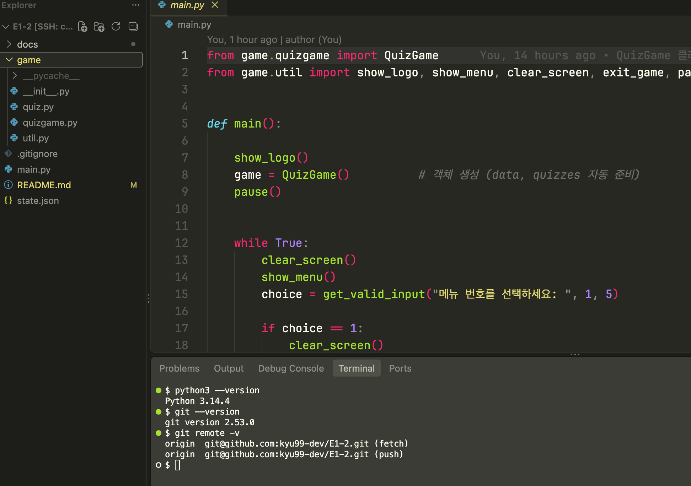

## ▶️ 실행 방법
```bash
python3 main.py
```
> Python 3.10 이상 환경에서 실행 가능하며, 개발은 Python 3.14.4 환경에서 진행했습니다.

## ✨ 기능 목록

### 기본 기능

- 퀴즈 풀기
- 정답 확인 및 점수 계산
- 최고 점수 기록 및 갱신
- 새 퀴즈 추가
- 퀴즈 목록 확인
- 게임 데이터 저장 / 불러오기
- JSON 파일 없음·손상 시 예외 처리

### 보너스 기능

- 퀴즈 풀기 시 문제 순서 랜덤 섞기
- 사용자가 풀 문제 수 선택
- 힌트 보기 기능
- 힌트 사용 시 점수 차감
- 등록된 퀴즈 삭제 기능
- 삭제 후 `state.json` 파일에 반영
- 날짜/시간, 푼 문제 수, 점수를 포함한 점수 기록 `history.json` 파일에 저장

## 📁 파일 구조
```
프로젝트/
├── main.py            # 프로그램 진입점, 메뉴 루프
├── state.json         # 게임 데이터 저장 파일
├── history.json       # 날짜/시간, 문제 수, 점수 저장 파일
├── docs/
│   └── screenshots/   # 실행 화면 캡처 이미지
└── game/
    ├── __init__.py    # 패키지 초기화
    ├── util.py        # 공용 유틸 함수
    ├── quiz.py        # Quiz 클래스
    └── quizgame.py    # QuizGame 클래스 (핵심 로직)
```

## 🗂️ 데이터 파일 설명
### 1. state.json
- **경로**: 프로젝트 루트 (`state.json`)
- **역할**: 최고 점수와 퀴즈 목록을 저장/불러오기
- **인코딩**: UTF-8
- **스키마**:
```text
{
  "quizzes": [
    {
      "question": string,
      "choices": string[],
      "answer": int
    }
  ],
  "best_score": {
    "correct": int,
    "total": int
  }
}
```
#### 항목 설명

| 항목 | 설명 |
|---|---|
| `quizzes` | 저장된 퀴즈 목록 |
| `question` | 퀴즈 문제 내용 |
| `choices` | 객관식 보기 목록 |
| `answer` | 정답 번호 |
| `hint` | 문제 풀이 중 볼 수 있는 힌트 |
| `best_score.correct` | 최고 점수에서 맞힌 문제 수 |
| `best_score.total` | 최고 점수 당시 푼 문제 수 |

### 2. history.json
- **경로**: 프로젝트 루트 (`history.json`)
- **역할**: 날짜/시간, 푼 문제 수, 점수 기록 저장/불러오기
- **인코딩**: UTF-8
- **스키마**:
```text
{
    "datetime": string,
    "question_count": int,
    "score": int
}
```

#### 항목 설명

| 항목 | 설명 |
|---|---|
| `datetime` | 퀴즈를 푼 날짜와 시간 |
| `question_count` | 해당 게임에서 푼 문제 수 |
| `score` | 해당 게임에서 얻은 점수 |


## 📷 실행 화면

### 로고 


### 메인 메뉴
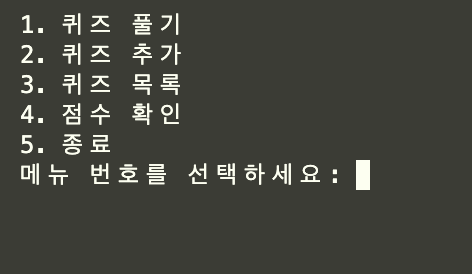

### 퀴즈 풀기
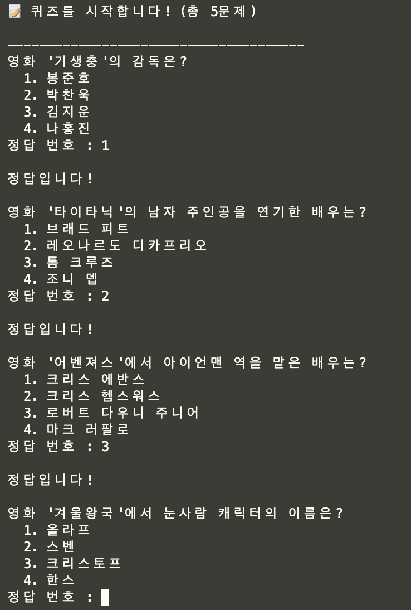

### 퀴즈 추가
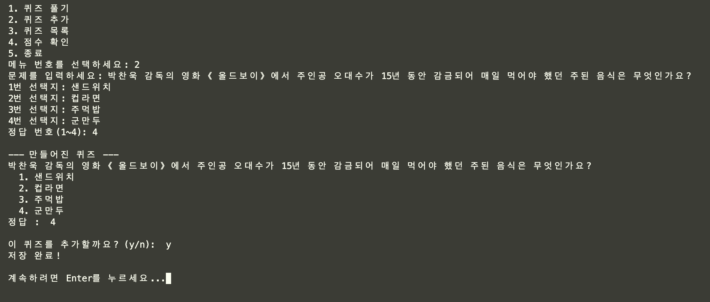

### 점수 확인


### 퀴즈 목록


---
### 문제 수 선택


### 힌트 보기
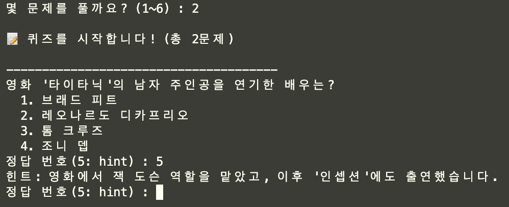

### 퀴즈 삭제
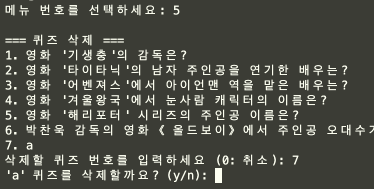

### 점수 기록 히스토리


## ⭐ 보너스 과제 구현 내용

### 1. 랜덤 출제

퀴즈를 풀 때 문제 순서가 항상 같으면 반복 플레이 시 쉽게 정답을 외울 수 있습니다.  
이를 방지하기 위해 `random` 모듈을 사용하여 퀴즈 순서를 무작위로 섞었습니다.

```python
random.sample(self.quizzes, count)
```

이를 통해 게임을 실행할 때마다 다른 순서로 문제가 출제되도록 구현했습니다.

---

### 2. 문제 수 선택

사용자가 전체 문제를 모두 풀지 않고, 원하는 문제 수만 선택해서 풀 수 있도록 구현했습니다.

예를 들어 저장된 퀴즈가 10개라면 사용자는 3문제, 5문제, 10문제처럼 원하는 개수를 선택할 수 있습니다.  
입력한 문제 수가 전체 퀴즈 수보다 많을 경우에는 잘못된 입력으로 처리하거나 전체 문제 수 범위 안에서 선택하도록 안내합니다.

이를 통해 사용자가 상황에 따라 짧게 또는 길게 퀴즈를 풀 수 있습니다.

---

### 3. 힌트 기능

`Quiz` 클래스에 `hint` 속성을 추가하여 각 문제마다 힌트를 저장할 수 있도록 했습니다.

```python
class Quiz:
    def __init__(self, question, choices, answer, hint=""):
        self.question = question
        self.choices = choices
        self.answer = answer
        self.hint = hint
```

퀴즈를 푸는 중 사용자가 힌트를 요청하면 해당 문제의 힌트를 보여줍니다.

힌트를 사용하면 정답을 맞히더라도 점수가 차감되도록 구현했습니다.  
이를 통해 힌트는 도움을 주지만, 점수에는 영향을 주는 방식으로 게임성을 추가했습니다.

---

### 4. 퀴즈 삭제 기능

등록된 퀴즈 목록을 확인한 뒤, 사용자가 원하는 퀴즈를 삭제할 수 있도록 구현했습니다.

퀴즈 삭제 후에는 변경된 퀴즈 목록을 다시 `state.json` 파일에 저장합니다.  
따라서 프로그램을 종료한 뒤 다시 실행해도 삭제된 퀴즈는 목록에 나타나지 않습니다.

---

### 5. 점수 기록 히스토리

기존 최고 점수 저장 기능에 더해, 모든 게임 기록을 저장하는 점수 기록 히스토리 기능을 구현했습니다.

각 기록에는 다음 정보가 저장됩니다.

| 저장 항목 | 설명 |
|---|---|
| 날짜/시간 | 퀴즈를 푼 시점 |
| 푼 문제 수 | 해당 게임에서 출제된 문제 수 |
| 점수 | 맞힌 문제 수 |

예시는 다음과 같습니다.

```text
1. 날짜/시간: 2026-11-16 14:30:21 | 푼 문제 수: 5 | 점수: 4/5
2. 날짜/시간: 2026-11-16 15:10:08 | 푼 문제 수: 3 | 점수: 3/3
```

이를 통해 사용자가 이전에 푼 기록을 확인하고, 자신의 점수 변화를 볼 수 있도록 했습니다.

---

### 6. 최고 점수 비교 방식

문제 수 선택 기능이 추가되면서 단순히 맞힌 문제 수만 비교하면 공정하지 않을 수 있습니다.

예를 들어 3문제 중 3문제를 맞힌 기록과 10문제 중 5문제를 맞힌 기록은 다음과 같이 비교할 수 있습니다.

```text
3 / 3 = 100%
5 / 10 = 50%
```

따라서 이 프로젝트에서는 최고 점수를 갱신할 때 다음 기준을 사용했습니다.

```text
1. 정답률이 더 높은 기록을 최고 점수로 저장
2. 정답률이 같다면 맞힌 문제 수가 더 많은 기록을 최고 점수로 저장
```

이 기준을 사용하면 사용자가 선택한 문제 수가 달라도 더 공정하게 최고 점수를 비교할 수 있습니다.


## 💾 GitHub 저장소 URL

`https://github.com/kyu99-dev/E1-2`

## 🧾 Git 커밋 기록 텍스트 증빙

아래는 `git log --oneline` 명령어로 확인한 커밋 기록입니다.  
프로젝트 진행 과정에서 10개 이상의 의미 있는 커밋을 남겼습니다.

```text
git log --oneline
d06590d (HEAD -> main, origin/main, origin/HEAD) docs: README 성능 테스트 내용추가
42774f5 Fix: 파일 읽기 예외처리 수정
95217d2 chore: 누락된 파일 재업로드
ba71207 feat : README 작성& 보너스과제
83e84ca feat: 퀴즈삭제기능추가
48ac412 feat: 힌트기능추가
2e1660f feat: 문제 수 선택 기능추가
876f642 feat: 랜덤 출제 기능
7b79bc2 docs: git 명령어 사용 증빙 추가
a275fff docs: README 정리
e3afa59 docs: clone 실습 문구 추가
7baed6a docs: README 작성
7c8a634 feat: 파일 없음·손상 시 예외 처리 추가
8200a91 QuizGame 클래스 구조로 리팩터링
6592fba feat: 최고 저수 저장,갱신,출력 기능 추가
ba323c6 style: 퀴즈 목록은 문제만 출력하도록 변경
afc4535 feat:퀴즈 목록 기능구현
794382a feat:퀴즈 추가 기능
8456046 (feature/quiz-play) feat: 퀴즈 풀기 기능 구현
4227ca2 feat: 기본 퀴즈 데이터 작성
4631c98 feat: Quiz 클래스 추가
28a6334 feat: 메뉴 기능 구현
5d1495f Init: 프로젝트 초기 설정 및 README, .gitignore, main.py 추가
835b5ac Initial commit
```
### 메시지 형식

```text
타입: 변경 내용
```

| 타입 | 의미 |
|---|---|
| feat | 새로운 기능 추가 |
| fix | 버그 수정 |
| docs | 문서 수정 |
| style | 코드 스타일 수정 |
| refactor | 코드 구조 개선 |
| chore | 기타 설정 및 파일 정리 |

#### 예시

```text
feat: 퀴즈 삭제 기능 추가
fix: 파일 읽기 예외 처리 수정
docs: README 성능 테스트 내용 추가
style: 퀴즈 목록 출력 형식 정리
refactor: QuizGame 클래스 구조 개선
chore: 누락된 파일 재업로드
```


## 🧾 Git 커밋 기록

```bash
git log --oneline --graph
```
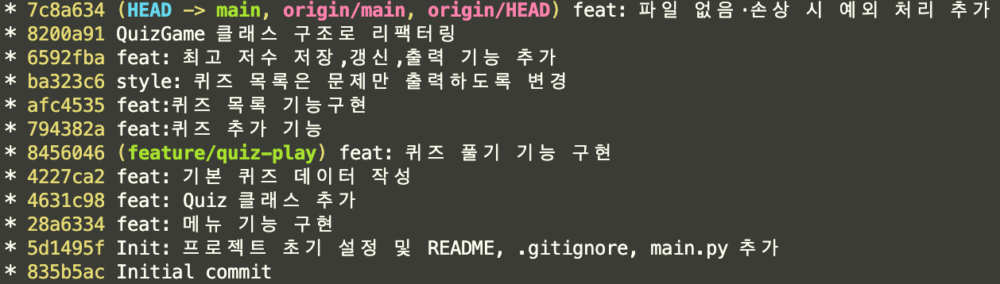


## 📍Git 저장소 복제 및 pull 실습

퀴즈 게임 개발 완료 후, `clone`과 `pull` 명령어를 실습하였다.

### 1. 저장소 복제

원격 저장소를 별도의 로컬 디렉터리에 복제하였다.

```bash
git clone git@github.com:kyu99-dev/E1-2.git
```

실행 결과:

```text
Cloning into 'E1-2'... 
remote: Enumerating objects: 59, done.
remote: Counting objects: 100% (59/59), done.
remote: Compressing objects: 100% (41/41), done.
remote: Total 59 (delta 24), reused 48 (delta 16), pack-reused 0 (from 0)
Receiving objects: 100% (59/59), 461.54 KiB | 816.00 KiB/s, done.
Resolving deltas: 100% (24/24), done.
```

### 2. 복제된 저장소에서 변경 후 push

복제된 저장소에서 README.md에 git clone 로그를 추가한 뒤 commit 후 push하였다.

```bash
git add .
git commit -m "docs: clone 실습 문구 추가"
git push
```

### 3. 기존 로컬 작업 디렉터리에서 pull

기존 로컬 작업 디렉터리에서 원격 저장소의 변경사항을 가져왔다.

```bash
git pull
```

실행 결과:

```text
Updating 7baed6a..e3afa59
Fast-forward
 README.md | 16 +++++++++++++++-
 1 file changed, 15 insertions(+), 1 deletion(-)
```

### 4. 실습 결과

`git pull` 실행 결과 변경사항이 정상 반영되었다.  
이를 통해 clone한 저장소에서 push한 README.md 변경사항이 기존 로컬 작업 디렉터리에 성공적으로 적용되었음을 확인하였다.

## 🛠️ Git 기초 명령어 사용 증빙

프로젝트 진행 과정에서 Git 기초 명령어 7종을 각각 한 번 이상 사용하였다.

| 명령어 | 사용 내용 | 증빙 |
|---|---|---|
| `git init` | 프로젝트 폴더를 Git 저장소로 초기화 | 초기 커밋 및 Git 저장소 생성 |
| `git add` | 변경 파일을 스테이징 영역에 추가 | 여러 커밋 생성 과정에서 사용 |
| `git commit` | 변경 사항을 커밋으로 저장 | `git log --oneline --graph` 결과 |
| `git push` | 로컬 커밋을 GitHub 원격 저장소에 업로드 | `origin/main`이 `HEAD -> main`과 동일 |
| `git pull` | 원격 저장소 변경 사항을 로컬에 반영 | Fast-forward 실행 결과 기록 |
| `git checkout` | 브랜치 이동 및 작업 브랜치 사용 | `feature/quiz-play` 브랜치에서 `main` 브랜치로 이동한 기록 |
| `git clone` | 원격 저장소를 별도 폴더에 복제 | clone 실행 결과 기록 |

### git checkout 실행 결과
---
```bash
git branch
```
```text
* feature/quiz-play
  main
```
---
```bash
git checkout main
```

```text
Switched to branch 'main'
Your branch is up to date with 'origin/main'.
```


## 🔄 프로그램 종료 시 데이터 동기화 방식

이 프로젝트는 퀴즈 추가, 퀴즈 삭제, 점수 기록 변경이 발생하면 즉시 JSON 파일에 데이터를 저장하도록 구현했습니다.

사용자가 메뉴에서 종료를 선택하거나 `Ctrl + C`, 입력 종료와 같은 예외 상황이 발생하더라도, 주요 데이터는 변경 시점마다 이미 파일에 저장되도록 하여 데이터 손실 가능성을 줄였습니다.

동기화 대상 파일은 다음과 같습니다.

| 파일 | 저장 내용 |
|---|---|
| `state.json` | 퀴즈 목록, 최고 점수 |
| `history.json` | 날짜/시간, 푼 문제 수, 점수 기록 |

정상 종료 또는 예외 종료가 발생하더라도, 퀴즈 목록과 점수 기록은 변경 시점마다 즉시 저장되므로 데이터 손실을 줄일 수 있습니다.

또한 `KeyboardInterrupt`, `EOFError` 발생 시에는 예외를 처리하여 사용자에게 종료 메시지를 출력하고 프로그램을 안전하게 종료합니다.

## 🧩 Quiz 클래스 설계 이유

이 프로젝트는 퀴즈 한 문제를 `Quiz` 클래스로 추상화했습니다. 퀴즈는 문제, 선택지, 정답처럼 서로 관련된 데이터를 함께 가지므로, 이를 하나의 객체로 묶어 관리하면 데이터 구조가 명확해집니다.

또한 정답 확인, 문제 출력과 같은 기능을 클래스 내부 메서드로 구현할 수 있어 퀴즈 관련 로직을 한곳에 모을 수 있습니다. 새로운 문제를 만들 때도 같은 구조의 `Quiz` 객체를 재사용하면 되므로 코드 중복을 줄이고 유지보수성을 높일 수 있습니다.


## 🛡️ 데이터 백업 및 복구

이 프로젝트는 퀴즈 데이터와 기록 데이터를 JSON 파일로 저장합니다.  
데이터 저장 중 문제가 발생하거나 JSON 파일이 손상되는 상황에 대비하기 위해 저장 전 기존 파일을 백업합니다.

`state.json`을 저장하기 전 기존 파일이 정상 JSON 형식이면 `state.json.bak` 파일로 백업합니다.  
이후 프로그램 실행 시 `state.json`이 손상되어 읽을 수 없는 경우, `state.json.bak` 파일을 읽어 자동 복구를 시도합니다.

`history.json`도 동일하게 저장 전 기존 파일이 정상 JSON 형식이면 `history.json.bak` 파일로 백업합니다.  
이후 프로그램 실행 시 `history.json`이 손상되어 읽을 수 없는 경우, `history.json.bak` 파일을 읽어 자동 복구를 시도합니다.

자동 복구에 실패하거나 백업 파일이 없는 경우에는 기본 초기 데이터로 새로 시작합니다.

### 수동 복구 방법

자동 복구가 되지 않는 경우 백업 파일을 원본 파일로 복사하여 수동 복구할 수 있습니다.

#### state.json/history 복구

리눅스 명령어

```bash
cp state.json.bak state.json
cp history.json.bak history.json
```

Windows 명령어

```powershell
cp state.json.bak state.json
cp history.json.bak history.json
```


## 대량 데이터 성능 테스트

### 테스트 목적

문제 데이터가 1000개 이상으로 증가했을 때 프로그램이 정상적으로 동작하는지 확인하고, 성능·메모리·검색 방식의 한계를 분석하였다.

### 테스트 시나리오

- 1000개 이상의 문제 데이터를 생성
- 생성된 문제를 프로그램에서 불러오기
- 문제 풀이 기능 실행
- 문제 목록 조회
- 정답 확인 및 점수 처리
- 프로그램 재실행 후 데이터 유지 여부 확인

### 테스트 결과

| 테스트 항목 | 테스트 내용 | 결과 |
|---|---|---|
| 데이터 생성 | 1000개 이상의 문제 데이터 생성 | 정상 생성 |
| 데이터 로딩 | 저장된 문제 데이터를 프로그램 실행 시 불러오기 | 정상 동작 |
| 문제 풀이 | 1000개 이상의 문제 중 선택하여 풀이 | 정상 동작 |
| 목록 조회 | 전체 문제 목록 확인 | 정상 출력 |
| 저장 및 유지 | 프로그램 종료 후 재실행 | 데이터 유지 확인 |
| 안정성 | 테스트 중 오류 또는 프로그램 중단 여부 | 오류 없음 |

#### 게임 실행

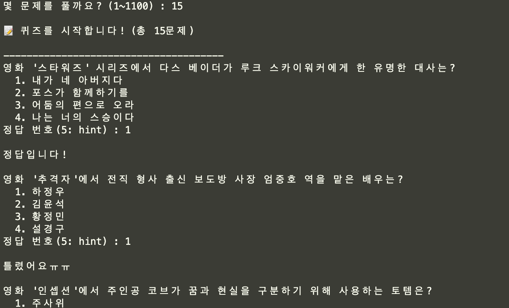

#### 퀴즈 목록 확인
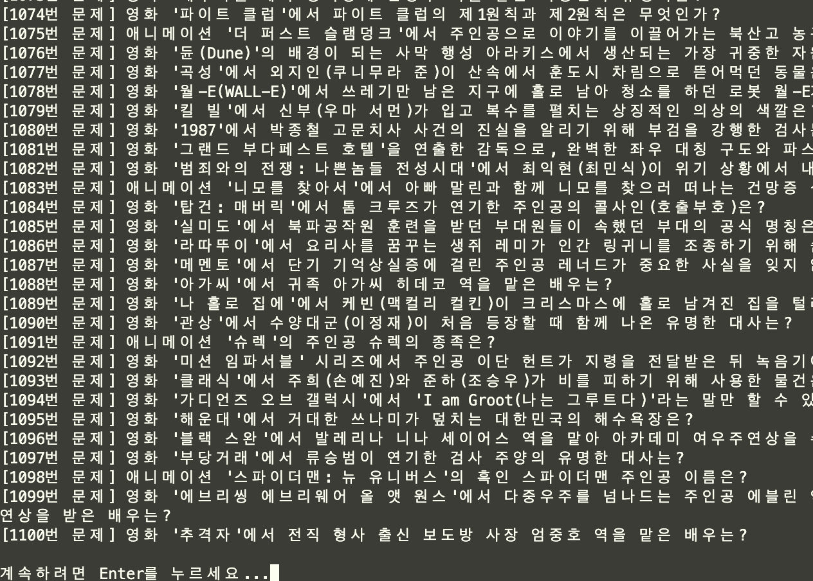

#### 퀴즈 삭제
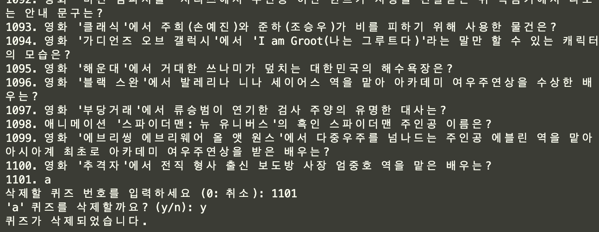

#### 퀴즈 추가
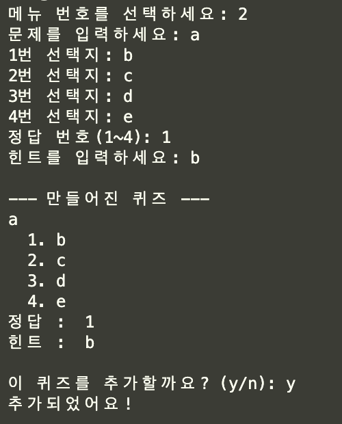

### 성능 분석

현재 프로그램은 문제 데이터를 파일에서 불러와 메모리에 저장한 뒤 사용하는 구조이다.

1000개 이상의 문제를 생성하고 직접 풀이 테스트를 진행한 결과, 문제 풀이와 데이터 조회 과정에서 프로그램이 중단되거나 오류가 발생하지 않았다.

다만 현재 구조에서는 전체 문제 데이터를 한 번에 불러오고, 목록 조회 시 전체 데이터를 순회하기 때문에 데이터가 더 많아질 경우 다음과 같은 성능 저하가 발생할 수 있다.

- 문제 수가 증가할수록 초기 데이터 로딩 시간이 증가할 수 있음
- 전체 목록 조회 시 출력 시간이 증가할 수 있음
- 저장 방식에 따라 전체 데이터를 다시 저장하는 과정에서 시간이 증가할 수 있음

### 메모리 분석

문제 데이터는 실행 중 메모리에 저장된다.  
각 문제는 문제 내용, 선택지, 정답, 힌트 등의 정보를 포함한다.

1000개 수준의 데이터에서는 메모리 부족이나 실행 중단 문제는 발생하지 않았다.  
하지만 모든 데이터를 한 번에 메모리에 올리는 구조이기 때문에, 데이터가 수만 개 이상으로 증가하면 메모리 사용량이 커질 수 있다.

향후 데이터 규모가 커질 경우에는 다음과 같은 개선이 필요하다.

- 필요한 데이터만 부분적으로 불러오기
- 데이터베이스 사용
- 페이지 단위로 목록 조회
- 오래 사용하지 않는 데이터는 메모리에서 제외

### 결론

1000개 이상의 문제 데이터를 생성하여 직접 테스트한 결과, 문제 풀이, 목록 조회, 저장 및 불러오기 기능이 정상적으로 동작하였다.

현재 구조는 1000개 수준의 데이터에서는 큰 문제가 없었지만, 데이터가 더 증가할 경우 전체 데이터 로딩, 전체 목록 조회, 순차 검색 방식에서 성능 저하가 발생할 수 있다.

따라서 향후 더 많은 데이터를 운영할 경우 데이터베이스 도입, 고유 ID 기반 관리, 인덱스 적용, 페이지 단위 조회 방식으로 개선할 계획이다.